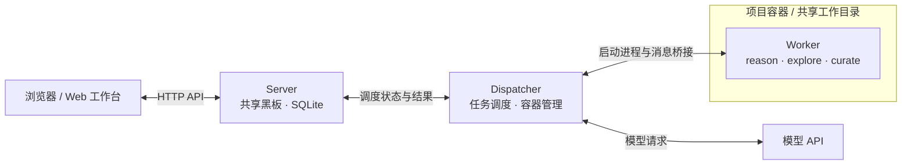

<div align="center">


# PwnMesh

**规划、执行、复核，让多 Agent 围绕事实与证据协作。**

[项目简介](#项目简介) · [核心能力](#核心能力) · [运行结构](#运行结构) · [安装教程](#安装教程) · [使用限制](#使用限制) · [授权说明](#授权说明)

</div>

## 项目简介

PwnMesh 是基于 Go 的多 Agent 任务执行系统，面向 CTF、授权渗透测试、代码审计与技术研究。系统根据用户目标规划任务，在项目容器中并行调用工具，记录执行证据，并据此调整计划、整理结果。

## 核心能力

- **任务协作**：规划、执行与结论整理分工，支持任务依赖、优先级和多方向并行探索。
- **Web 与客户端分析**：支持浏览器操作、HTTP 请求重放、代码审计，以及 APK/JAR 静态分析。
- **图式执行**：组合命令节点与子 Agent，按依赖和条件执行，汇总各分支结果。
- **证据与恢复**：保留事实、候选结论、争议和原始证据，支持输入快照、会话持久化与执行恢复。
- **Web 工作台**：创建项目、上传材料、补充信息，查看任务图与执行记录，暂停、继续、终止、重启或导出项目。

## 运行结构



| 角色 | 职责 |
| --- | --- |
| `reason` | 根据用户目标与有效事实制定计划，检查完成条件 |
| `explore` | 执行具体任务，调用工具并提交事实与证据 |
| `curate` | 按需整理候选结论、重复信息与争议 |

Compose 启动 Server 和 Dispatcher；Dispatcher 在同一调度命名空间内按项目创建并复用容器。多个 Worker 以独立进程运行，共享 `/workspace`，模型调用和共享状态读写经 Dispatcher 桥接。Server 数据存入 Docker 命名卷，执行记录保存在项目容器的 `/workspace/.pwnmesh/runs/`。

## 安装教程

需要 Linux x86_64、Docker Engine、Docker Compose 插件，以及兼容 Anthropic Messages 流式响应和工具调用的模型服务。完整 Worker 使用 Kali 环境，首次构建需下载工具及浏览器依赖。

```bash
git clone --branch main https://github.com/do-whilefor/PwnMesh.git
cd PwnMesh
cp .env.example .env
cp dispatch.example.yaml dispatch.yaml
```

编辑 `.env`，填写 `ANTHROPIC_AUTH_TOKEN`、`ANTHROPIC_BASE_URL` 和 `ANTHROPIC_DEFAULT_FABLE_MODEL`。按实际模型能力调整 `dispatch.yaml` 中的输出、上下文预算及并发设置，再依次执行：

```bash
docker build -t pwnmesh:dev .
docker build -f container/Dockerfile -t pwnmesh-worker:dev .
docker compose up -d --no-build
```

打开 [http://127.0.0.1:8000](http://127.0.0.1:8000)，创建项目、填写目标和操作范围，并上传所需材料。模型设置也可在工作台中管理。配置示例见 [dispatch.example.yaml](./dispatch.example.yaml)，工具环境见 [container/environment.md](./container/environment.md)。

## 使用限制

使用前请阅读 [免责声明与使用合规须知](./DISCLAIMER.md)。

- 仅在合法授权及许可证允许的范围内使用；APK/JAR 能力以静态分析为主，不等同于真实设备上的运行验证。
- 模型输出、工具命中和完成结论需要结合原始证据人工复核；上传材料应符合保密要求及模型服务的数据处理约定。
- 在可信环境部署：Dispatcher 挂载 Docker Socket，Worker 默认以 root 运行；同一项目共享工作目录，容器不应被视为绝对安全边界。

## 授权说明

PwnMesh 采用 [PolyForm Noncommercial License 1.0.0](./LICENSE)。可在许可证规定的范围内进行非商业使用、研究、修改和分发；超出许可范围的商业用途需另行取得权利人授权。完整条款以许可证为准。
