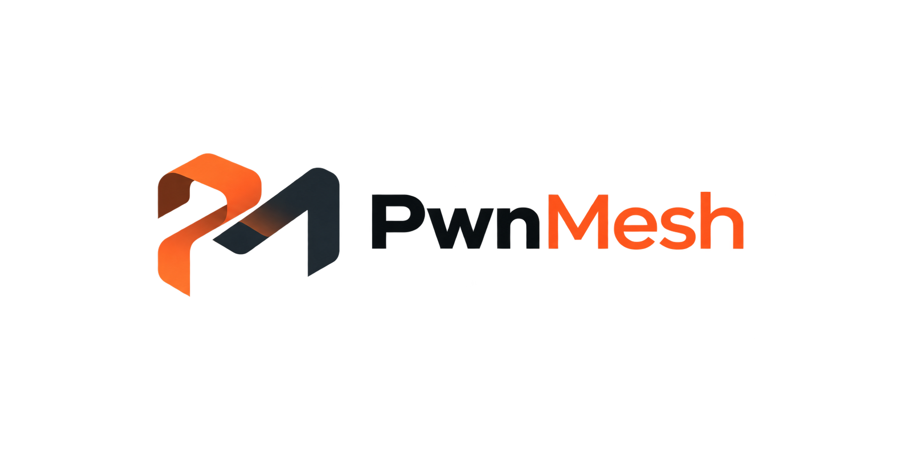
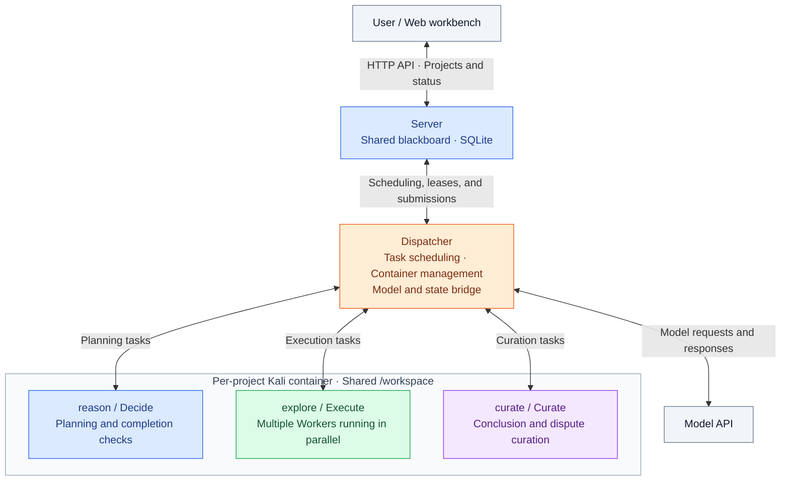

<div align="center">

<picture>
  <source media="(prefers-color-scheme: dark)" srcset="./web/public/brand-dark.png">
  
</picture>


**A collaborative AI exploration system with multiple Workers for CTFs, authorized penetration testing, and code audits**

*Plan centrally. Explore in parallel. Keep the evidence.*

[](https://go.dev/)
[](https://www.docker.com/)
[](#requirements)
[](./LICENSE)

[Overview](#overview) · [Features](#features) · [Quick Start](#quick-start) · [Usage Limits](#usage-limits-and-security) · [License](#license)

</div>

## Overview

PwnMesh is a multi-agent task execution system written in Go for CTFs, authorized penetration testing, code audits, and technical research. It plans tasks around the user's goals, runs tools in parallel within project containers, records execution evidence, and uses that evidence to adjust plans and consolidate results.

## Features

- **Task collaboration:** Separate planning, execution, and conclusion curation, with task dependencies, priorities, and parallel exploration of multiple approaches.
- **Web and client analysis:** Browser interaction, HTTP request replay, code audits, and static APK/JAR analysis.
- **Graph execution:** Combine command nodes and sub-agents, execute according to dependencies and conditions, and aggregate branch results.
- **Evidence and recovery:** Retain facts, candidate conclusions, disputes, and raw evidence, with input snapshots, session persistence, and execution recovery.
- **Web workbench:** Create projects, upload materials, add information, inspect task graphs and execution records, and pause, resume, terminate, restart, or export projects.

## Architecture



| Role | Responsibility |
| --- | --- |
| `reason` | Plan from the user's goals and valid facts; check completion conditions |
| `explore` | Execute specific tasks, call tools, and submit facts and evidence |
| `curate` | Curate candidate conclusions, duplicate information, and disputes as needed |

Compose starts the Server and Dispatcher. The Dispatcher creates and reuses containers per project within the same scheduling namespace. Workers run as separate processes and share `/workspace`; model calls and shared state reads and writes go through the Dispatcher. Server data is stored in a Docker named volume, and execution records are saved in `/workspace/.pwnmesh/runs/` inside each project container.

<a id="quick-start"></a>
<a id="requirements"></a>

## Installation

Requires Linux x86_64, Docker Engine, the Docker Compose plugin, and a model service compatible with Anthropic Messages streaming responses and tool calls. The full Worker uses a Kali environment; the initial build downloads tools and browser dependencies.

```bash
git clone --branch main https://github.com/do-whilefor/PwnMesh.git
cd PwnMesh
cp .env.example .env
cp dispatch.example.yaml dispatch.yaml
```

Edit `.env` to set `ANTHROPIC_AUTH_TOKEN`, `ANTHROPIC_BASE_URL`, and `ANTHROPIC_DEFAULT_FABLE_MODEL`. Adjust output and context budgets and concurrency settings in `dispatch.yaml` to match your model's capabilities, then run these commands in order:

```bash
docker build -t pwnmesh:dev .
docker build -f container/Dockerfile -t pwnmesh-worker:dev .
docker compose up -d --no-build
```

Open [http://127.0.0.1:8000](http://127.0.0.1:8000), create a project, specify its goals and scope of operations, and upload the required materials. Model settings can also be managed in the workbench. See [dispatch.example.yaml](./dispatch.example.yaml) for configuration and [container/environment.md](./container/environment.md) for the tool environment.

## Usage Limits and Security

Read the [Disclaimer and Usage Compliance Notice](./SECURITY.md) before use.

- **Legal authorization:** Use only on your own systems, explicitly authorized targets, and CTFs or labs that permit testing. Stay within the authorized assets, time window, and operations. Unauthorized intrusion, data theft, and destruction are prohibited.
- **Human review:** Verify model judgments, tool findings, and project completion status against raw evidence, actual impact, and coverage.
- **Trusted deployment:** The Dispatcher mounts the Docker socket, and Workers run as root by default. Containers and files are shared within each project, so writes to shared files require coordination.
- **Information protection:** Source code, logs, credentials, and other inputs must meet confidentiality requirements and the model service's data processing terms.
- **Resource control:** Set concurrency, execution deadlines, and model budgets for your host and target environment, and retain the necessary task data and evidence.

Users are responsible for test authorization, their actions, and the resulting consequences.

## License

PwnMesh is licensed under the [PolyForm Noncommercial License 1.0.0](./LICENSE). Noncommercial use, research, modification, and distribution are permitted within the license's terms. Commercial use outside that scope requires separate authorization from the rights holder. The license governs the full terms.

<div align="center">

**PwnMesh · For authorized security research only.**

> Pre-refactoring commit SHA: a6fde4dd2c4061f997966c1e08436d2cc583f9b0

</div>
